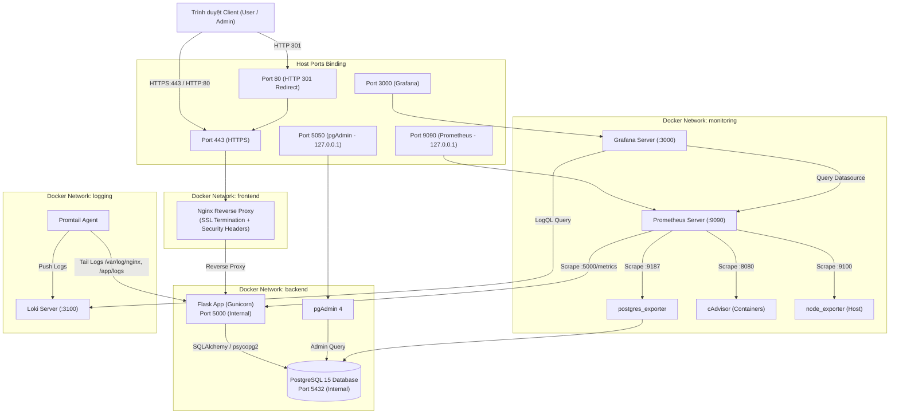

# HỆ THỐNG QUẢN LÝ THƯ VIỆN (LIBRARY MANAGEMENT SYSTEM)
### Đồ án môn học: Triển khai và Quản trị Hệ thống Phần mềm

[](https://docs.docker.com/compose/)
[](https://python.org/)
[](https://www.postgresql.org/)
[](https://nginx.org/)
[](https://prometheus.io/)
[](https://grafana.com/)
[](https://grafana.com/oss/loki/)

---

## 1. Giới Thiệu Đề Tài & Mục Tiêu

Dự án **Hệ Thống Quản Lý Thư Viện** là một giải pháp hoàn chỉnh từ tầng ứng dụng (Application), cơ sở dữ liệu (Database), tầng mạng định tuyến bảo mật (Reverse Proxy & TLS), đến hệ thống giám sát phân tán (Monitoring - Prometheus & Grafana) và thu thập log tập trung (Centralized Logging - Loki & Promtail).

Toàn bộ hệ thống được đóng gói container hóa theo tiêu chuẩn DevOps hiện đại, triển khai thông qua **Docker Compose**, giúp sinh viên và quản trị viên có thể vận hành trên môi trường máy chủ cục bộ hoặc đám mây chỉ bằng một dòng lệnh.

### Mục Tiêu Chính
1. **Nghiệp vụ thư viện**: Quản lý đầu sách, danh mục, độc giả, quá trình mượn/trả sách, kiểm soát tồn kho trong giao dịch ACID với cơ chế khóa dòng (Row-level Locking) chống mượn vượt số lượng khả dụng.
2. **Reverse Proxy & Bảo mật**: Nginx làm điểm tiếp nhận duy nhất, tự động chuyển hướng HTTP sang HTTPS (chứng chỉ TLS tự ký), cấu hình bảo mật Security Headers (`CSP`, `X-Frame-Options`, `X-Content-Type-Options`), container non-root và phân tách mạng (Network Isolation).
3. **Giám sát thời gian thực**: Prometheus tự động cào metrics từ ứng dụng Flask (`/metrics`), cơ sở dữ liệu (`postgres_exporter`), container (`cAdvisor`) và máy chủ (`node_exporter`). Grafana tự động nạp (provision) dashboard trực quan hóa.
4. **Quản trị log tập trung**: Thu thập log ứng dụng, log truy cập Nginx và log lỗi hệ thống qua Promtail chuyển tiếp về Loki, truy vấn phân tích bằng LogQL.

---

## 2. Công Nghệ Bắt Buộc Sử Dụng

- **Frontend**: HTML5, CSS3, Bootstrap 5.3, Bootstrap Icons, JavaScript.
- **Backend**: Python 3.10 (Flask Framework, SQLAlchemy ORM, Flask-WTF CSRF Protection, Gunicorn WSGI).
- **Cơ sở dữ liệu**: PostgreSQL 15 Alpine.
- **Công cụ quản trị DB**: pgAdmin 4.
- **Reverse Proxy**: Nginx 1.25 Alpine (TLS 1.2/1.3, HTTP/2).
- **Hệ thống giám sát**: Prometheus v2.50.1 & Grafana v10.3.3.
- **Exporters**: `postgres_exporter`, `cadvisor`, `node_exporter`, `prometheus_client` cho Flask.
- **Thu thập log**: Grafana Loki v2.9.4 & Promtail v2.9.4.
- **Đóng gói & điều phối**: Docker & Docker Compose.

---

## 3. Kiến Trúc Hệ Thống & Sơ Đồ Mạng

Hệ thống được thiết kế theo mô hình phòng thủ theo chiều sâu (Defense in Depth) với các mạng Docker biệt lập:



---

## 4. Bảng Các Cổng Và URL Truy Cập

| Dịch vụ | URL Truy cập Local | Cổng Container | Phạm vi truy cập | Mô tả chức năng |
| :--- | :--- | :--- | :--- | :--- |
| **Thư viện Web (HTTPS)** | `https://localhost` hoặc `https://127.0.0.1` | `443` | Công khai | Điểm truy cập chính của hệ thống thư viện |
| **Thư viện Web (HTTP)** | `http://localhost` | `80` | Công khai | Tự động chuyển hướng 301 sang HTTPS |
| **pgAdmin 4** | `http://localhost:5050` | `80` | `127.0.0.1` | Giao diện quản trị cơ sở dữ liệu PostgreSQL |
| **Grafana** | `http://localhost:3000` | `3000` | Nội bộ / Host | Dashboard quan sát metrics và truy vấn LogQL |
| **Prometheus** | `http://localhost:9090` | `9090` | `127.0.0.1` | Bảng điều khiển kiểm tra scrape targets & PromQL |
| **PostgreSQL** | `localhost:5432` | `5432` | `127.0.0.1` | Cổng dữ liệu nội bộ (chống truy cập ngoài) |
| **Flask Backend** | `web:5000` | `5000` | Nội bộ (`frontend`/`backend`) | Không expose ra ngoài; chỉ Nginx proxy tới |
| **Loki** | `loki:3100` | `3100` | Nội bộ (`logging`) | Dịch vụ lưu trữ log phân tán |

---

## 5. Hướng Dẫn Khởi Động Nhanh Hệ Thống

### Bước 1: Chuẩn bị môi trường
Yêu cầu máy tính cài đặt:
- **Docker Desktop** (hoặc Docker Engine & Docker Compose v2 trở lên).
- **Git**.
- **Python 3.10+** (tùy chọn, để chạy script sinh certs/seed cục bộ nếu muốn).

### Bước 2: Clone repository & Thiết lập biến môi trường
```bash
# Clone repository
git clone https://github.com/[TÊN_TAI_KHOAN]/[TEN_REPO].git
cd Quanlythuvien

# Tạo file cấu hình môi trường từ mẫu
cp .env.example .env
# (Trên Windows CMD: copy .env.example .env)
# (Trên Windows PowerShell: Copy-Item .env.example .env)
```
> [!NOTE]
> Mở file `.env` và kiểm tra hoặc thay đổi mật khẩu mặc định nếu cần.

### Bước 3: Sinh chứng chỉ SSL tự ký cho Nginx
Hệ thống tích hợp sẵn script Python tự động tạo cặp khóa 2048-bit RSA và chứng chỉ X.509:
```bash
python scripts/generate_ssl.py
```
Chứng chỉ sẽ được tạo tại thư mục `docker/nginx/certs/library.crt` và `docker/nginx/certs/library.key`.

### Bước 4: Khởi động hệ thống với Docker Compose
```bash
# Build và chạy ngầm toàn bộ dịch vụ
docker compose up -d --build

# Kiểm tra trạng thái các container
docker compose ps
```

### Bước 5: Khởi tạo dữ liệu mẫu (Seed Data)
Sau khi container cơ sở dữ liệu và ứng dụng đã ở trạng thái healthy, chạy lệnh sau để nạp dữ liệu mẫu:
```bash
docker compose exec web python scripts/seed.py
```
*(Hoặc chạy trực tiếp trên máy host: `python scripts/seed.py` nếu kết nối database).*

### Bước 6: Truy cập và trải nghiệm
- Mở trình duyệt truy cập: `https://localhost`
  - *Lưu ý*: Do sử dụng chứng chỉ tự ký (Self-signed Certificate) để demo cục bộ, trình duyệt có thể hiển thị cảnh báo bảo mật. Hãy nhấn **"Nâng cao" (Advanced) -> "Tiếp tục truy cập" (Proceed to localhost)**.
- Đăng nhập pgAdmin tại `http://localhost:5050`:
  - **Email**: `admin@library.local`
  - **Mật khẩu**: `ChangePgAdminPassword123!` (hoặc giá trị trong file `.env`)
  - Kết nối DB: Host: `db`, Port: `5432`, Username: `library_user`, Password: giá trị trong `.env`.
